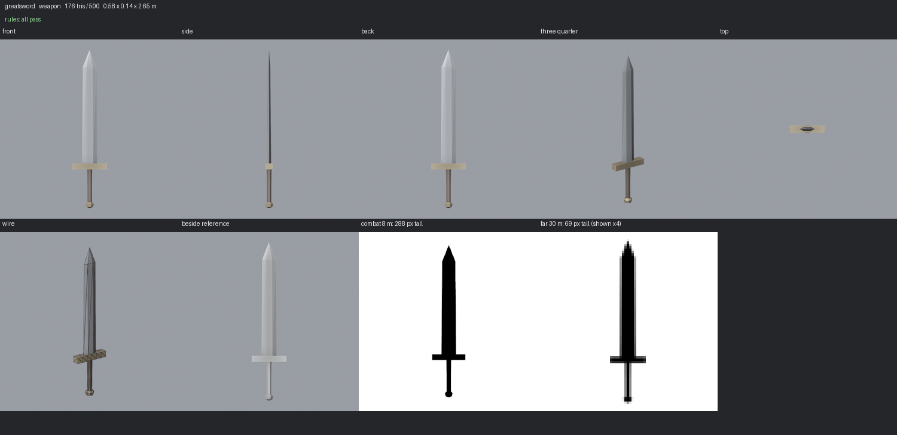

# asset-foundry

Recipe-built 3D assets, made in parallel **variant rounds** and reviewed in a **catalog**.

You ask for an asset. An agent (or you) writes a small JSON recipe per variant, and the
foundry builds 5–20 of them at once, checks each against your budgets and renders a sheet.
You scroll the round in a local review page: like, cut or comment on each variant, and pin,
arrow or lasso the exact spot you mean. The next round is made from your notes, and rounds
repeat until one to three variants are worth using.

It is built for working with AI agents. Every command prints short, fixable output; every
rule failure says how to fix the recipe; your marks come back as part terms ("blade, 95% to
the tip, +0.23 m along its length") rather than screen pixels. It works just as well by
hand.



## What it does

- **Recipes, not modelling.** An asset is a JSON list of parts (blade, guard, grip,
  lathe, block, loft...) placed on each other's anchors. Same recipe and seed, same mesh.
- **Shapes in plain Python.** Geometry is built without Blender, so it is deterministic and
  unit-testable. Blender runs headless only to export glTF and render.
- **Checks before anyone looks.** Tri budget, closed mesh, outward normals, sockets, size
  range, per asset family.
- **A sheet per variant.** Turnaround, wireframe, beside a reference figure, and the
  silhouette at the size it will have on screen at the distances you set.
- **Rounds with lineage.** Each variant records which earlier variants it came from and
  which notes it answers.
- **A review page.** 3D view, sheet and side-by-side compare; like / cut / use by key;
  pin, arrow and lasso marks; notes per reviewer. Local only, works offline.
- **Game-agnostic.** A profile (TOML) sets your families, budgets, reference figure, view
  distances and hooks. Nothing here assumes an engine; the export is binary glTF, Y-up.

## Install

Needs Python 3.11+ and [Blender](https://www.blender.org/) 5.1+ (for export and renders;
recipes, checks and tests run without it).

```bash
git clone <this repo> && cd asset-foundry
pip install -e ".[dev]"
foundry doctor            # finds Blender, lists parts and families
python -m pytest          # the tests, no Blender needed
```

Blender is found from the profile's `[foundry] blender`, then `$BLENDER`, then `PATH`, then
the newest standard Windows install.

## Quick start

```bash
foundry --profile examples/profile.toml build examples/weapon/greatsword.json
```

It prints PASS or FAIL, the tri count, size and mesh hash, any failed rule with its fix, and
the path of `sheet.png`. **Look at the sheet.**

## Rounds

```bash
export FOUNDRY_PROFILE=examples/profile.toml
foundry new swords --family weapon --ask "heavy two-handers, readable at 30 m"
foundry round new swords my_recipes/*.json --brief "twelve takes on the form"   # builds in parallel
foundry round fix swords r1-C fixed.json     # replace one recipe and rebuild it
foundry round drop swords r1-F               # take one out before submitting
foundry round submit swords                  # refuses unless every variant passes
foundry review                               # the review page: http://127.0.0.1:8765/
foundry feedback swords                      # after "Round reviewed": what to make next
foundry status
```

A recipe in a round may carry `"brief"` (one line: the take) and
`"lineage": {"parents": ["r1-B"], "answers": ["r1-B: heavier guard"]}`.

**Review page keys:** arrows move · `L` like · `X` cut · `U` use · `0` clear · `C` comment ·
`Space` add to compare · `S` 3D/sheet · `V` compare · `P` pin · `D` arrow · `A` lasso ·
`Esc` stop marking · `Z` undo. Verdicts save as you go, one set per reviewer. "Round
reviewed" hands the round back.

`foundry feedback` prints the reviewed round grouped as use / liked / cut / no verdict, with
every comment and mark in part terms, ready to plan the next round from (`--json` for
tools).

## Recipes

```json
{
  "family": "weapon", "name": "greatsword", "seed": 1,
  "parts": [
    {"id": "blade", "part": "blade", "length": 1.9, "width": 0.25, "outline": [[0, 1], [0.85, 0.92], [1, 0]]},
    {"id": "guard", "part": "guard", "at": "blade.base", "span": 0.58},
    {"id": "grip",  "part": "grip",  "at": "guard.back", "length": 0.55},
    {"id": "pommel", "part": "lathe", "at": "grip.end", "region": "trim", "profile": [[0.05, 0], [0.075, 0.03], [0, 0.1]]}
  ],
  "sockets": {"grip": "grip.mid"},
  "origin": "grip"
}
```

- Axes: x right, y forward, z up, metres.
- `part` names a builder; every other key is that builder's parameter (`foundry parts <name>`).
- `at` puts the part's origin on an earlier part's anchor. Placement keys: `offset`
  `[x, y, z]` in the anchor's frame, `turn` (degrees about its z), `mirror` (adds a copy
  mirrored across x), `region`.
- `region` names a colour region (exported as a named material slot). Recipes never hold
  materials; your engine assigns the look.
- `sockets` export as empty nodes; `origin` moves one socket to the model's origin.
- Unknown keys, parts and anchors are errors that list what is allowed.

More in `examples/`: a sword, a bottle and a pillar.

## Builders

| Part | Makes |
|---|---|
| `lathe` | a profile turned round an axis: pommels, bottles, pots, pillars |
| `block` | a box with chamfered corners and taper: bricks, slabs, crates, plinths |
| `loft` | sections stacked up z (rect, lens or round): hafts, posts, columns, crystals |
| `blade`, `guard`, `grip` | held-weapon parts |

`foundry parts` prints each one's parameters, defaults, anchors and axes from the code.

### Adding a builder

A builder is a function decorated with `@part(...)` in `foundry/parts/<family>.py`, or in
your own module listed in the profile's `parts`. It builds in its own frame (attach point at
the origin, +z pointing away from its parent) from `geom.sweep` stations, and returns the
mesh, its anchors and the real spans of its parameter axes (which is how marks become part
terms). Add it to the test that checks every builder makes a closed, outward mesh.

## Profile

A TOML file; `examples/profile.toml` documents every key. `[foundry]` (root, blender,
catalog, parallel, reference, parts), `[views]` (silhouette distances), `[family.<name>]`
(tri_budget, sockets, size_min/max, allow_open, extent, reference_offset, round_first,
round_next, region_tints) and `[hooks]` (commands run when a round is ready or reviewed).

## Outputs

Each variant's folder holds `recipe.json`, `model.glb` (one merged mesh plus socket nodes),
`parts.glb` (one node per part, for the review page), `parts.json` (each part's frame,
anchors and axes), `report.json` (stats and rule results), `renders/` and `sheet.png`.
Collections live under the profile's `catalog` as plain files.

## Contributing

See `CONTRIBUTING.md` (people) and `AGENTS.md` (AI agents). The short version: tests pass
without Blender, errors say how to fix, and nothing from your own projects comes into this
repo (a pre-commit check helps: `git config core.hooksPath tools/hooks`).

## Status

Early and in use: one project builds its weapons with it. Not built yet: an MCP server for
agents (the CLI covers the same ground today), parent marks redrawn on child variants, and
more builder families. See `CONTRIBUTING.md`.

## Licence

MIT, see `LICENSE`. Third-party notices: `THIRD_PARTY_NOTICES.md`.
